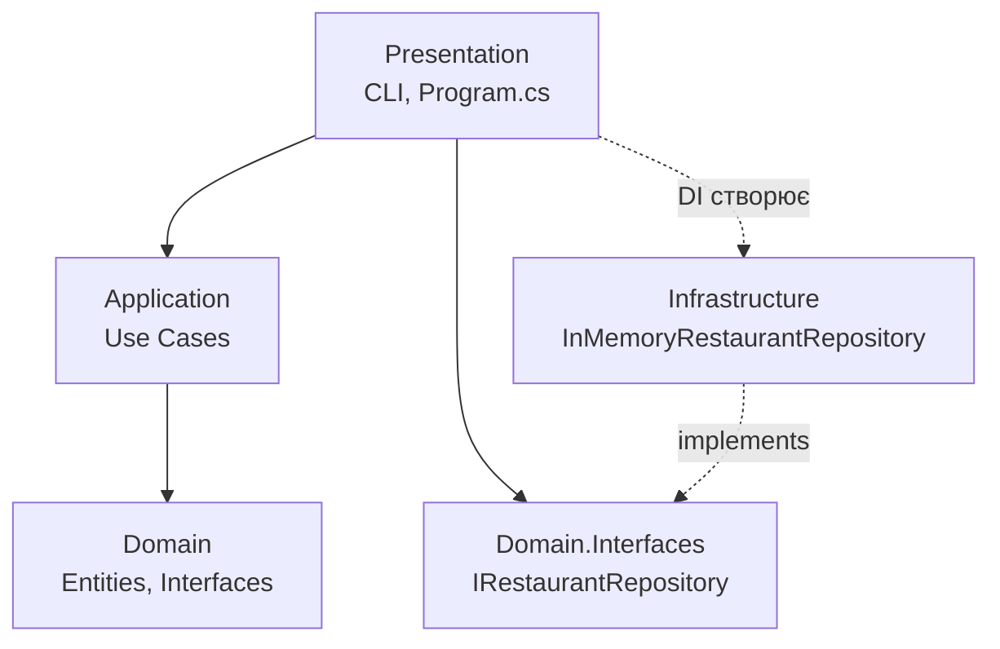

# task-manager-clean-arch
Laboratorna robota №5
# Сервіс доставки їжі (Clean Architecture)

Цей проєкт реалізує сервіс доставки їжі з використанням шаруватої архітектури (Clean Architecture) на C#.

## Архітектура шарів

**Напрямок залежностей:** Presentation -> Application -> Domain; Infrastructure -> Domain (реалізує інтерфейси). Domain не залежить ні від чого.

## Структура проєкту
- `src/Domain/Entities/Restaurant.cs` — сутність ресторану.
- `src/Domain/Interfaces/IRestaurantRepository.cs` — інтерфейс для роботи з даними.
- `src/Application/UseCases/` — бізнес-логіка.
- `src/Infrastructure/Repositories/InMemoryRestaurantRepository.cs` — зберігання даних.
- `src/Presentation/Cli/Program.cs` — консольний інтерфейс та Dependency Injection.
